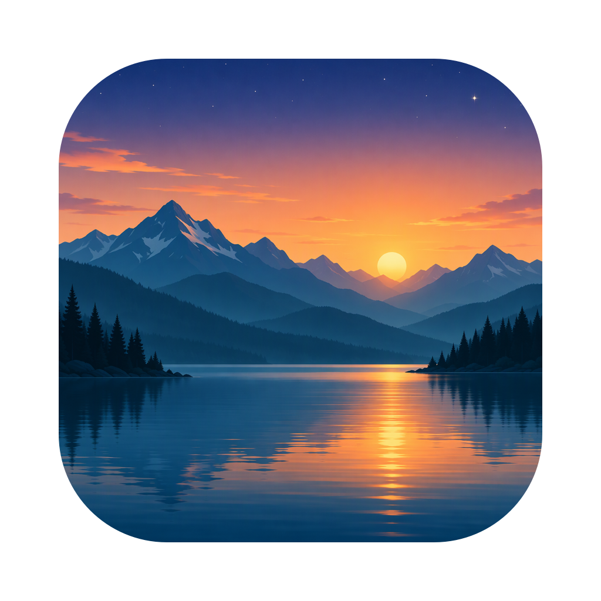

Made by [Najam](https://najam.dev)

# Daily Wallpaper

[](LICENSE)
[](https://github.com/itsnajam/daily-wallpaper/releases/latest)
[](https://github.com/itsnajam/daily-wallpaper/releases)

A free, lightweight Mac menu bar app that sets a fresh Bing photo as your desktop
and lock screen wallpaper, on your schedule. Pick the types you love (landscapes
by default) and how often it changes. No account, no tracking, no clutter.



> Screenshot placeholder: replace `docs/icon.png` above with a capture of the menu
> bar dropdown once the app is running.

## What it does

- Fetches Bing's public image feed (no API key, no account) from several markets.
- Filters by the wallpaper types you pick: **Landscapes**, **Cities & architecture**,
  **Beaches & islands**, **Animals & wildlife**, **Space & night sky**, or **Everything**.
- Downloads the newest matching photo in full resolution and sets it on every display.
- Keeps the lock screen on the same photo (one-time setup, see below).
- Deletes the previous photo, so only the current image ever stays on disk.
- Changes on your schedule: 1, 3, 6, 12 (default) or 24 hours, or manual only.
  It also refreshes at launch and when your Mac wakes.
- If you are offline or a download fails, it leaves your wallpaper alone.

Under 5 MB on disk, near-zero CPU when idle. No Electron, no web views, no helper
daemons. The only network calls are to `bing.com`. No ads, popups, notifications,
tracking or analytics.

## Download

Grab the latest `Daily-Wallpaper.zip` from
[Releases](https://github.com/itsnajam/daily-wallpaper/releases/latest), unzip it,
and drag **Daily Wallpaper** into your Applications folder.

**The app is unsigned.** The first time, **right-click it and choose Open**, then
confirm in the dialog. After that it opens normally. (macOS 14 or later, Apple
Silicon and Intel.)

## The menu

Click the mountain icon in your menu bar:

- A thumbnail of the current photo with its Bing title and photographer credit.
- **Next wallpaper**: fetch a new one now.
- **Change every**: 1h / 3h / 6h / 12h / 24h / Manual only. Changes apply right away.
- **Wallpaper types**: tick one or more types. At least one stays selected.
- **Open at Login**: start the app when you sign in.
- **Lock screen: synced ✓**: or a one-click fix when it is not synced.
- **About** and **Quit**.

## Lock screen

To sync the lock screen, pick the current photo once in System Settings >
Wallpaper and turn on **Show on all Spaces**. The photo is in **Pictures → Daily
Wallpaper** (the picker hides `~/Library`). After that one-time pick, every new
photo appears on the lock screen automatically. The menu shows "Lock screen:
synced ✓" when it matches your desktop, or "Lock screen not synced, click to fix"
otherwise.

## Prefer no app? Use the CLI

A shell-script version lives in [`cli/`](cli/) with the same types and schedule,
driven by launchd instead of a menu bar app.

```sh
cd cli
./install.sh                              # installs bingwall + a 12-hour LaunchAgent
bingwall                                  # fetch and set a new wallpaper now
bingwall --types landscapes,cities        # choose types (remembered)
bingwall --every 6h                       # change the schedule (remembered)
BW_TYPES=space bingwall                   # one-run override via env var
./uninstall.sh                            # remove it
```

Types: `landscapes`, `cities`, `beaches`, `animals`, `space`, `everything`.
Intervals: `1h`, `3h`, `6h`, `12h`, `24h`, `manual`. For the lock screen, pick the
current photo once (Pictures → Bing Wallpaper) with Show on all Spaces on.

## Build from source (no Xcode)

You only need the Command Line Tools (`xcode-select --install`).

```sh
./build.sh
```

This compiles a universal binary with `swiftc`, assembles `Daily Wallpaper.app`
(Info.plist, icon, `LSUIElement`), ad-hoc signs it, and writes
`dist/Daily-Wallpaper.zip`. The built app is in `build/`.

## How the types work

Each type is a keyword list matched against the photo's Bing `title` and
`copyright`, kept in one easy-to-edit file:
[`app/Sources/Categories.swift`](app/Sources/Categories.swift). Matching is
case-insensitive, whole-word, and tolerates simple plurals. One photo can match
several types. The app queries several markets (`en-US`, `en-GB`, `en-CA`, `en-AU`,
`en-IN`), de-duplicates by scene, and remembers the last ~30 shown photos so
nothing repeats too soon. If nothing new matches your types, it keeps the current
wallpaper and tells you in the menu. It never falls back to a type you did not pick.

## Image rights

The photos belong to Microsoft/Bing and their photographers. This tool only
downloads them for your personal wallpaper use and never redistributes them. Each
photo's copyright text is shown in the menu and recorded in the log so the credit
is kept.

## Repo layout

```
app/      Swift source for the menu bar app
cli/      shell-script version (bingwall, install, uninstall)
docs/     landing page for GitHub Pages
build.sh  builds the app with the Command Line Tools
```

## License

MIT. See [LICENSE](LICENSE).

Need an app built? [najam.dev](https://najam.dev)